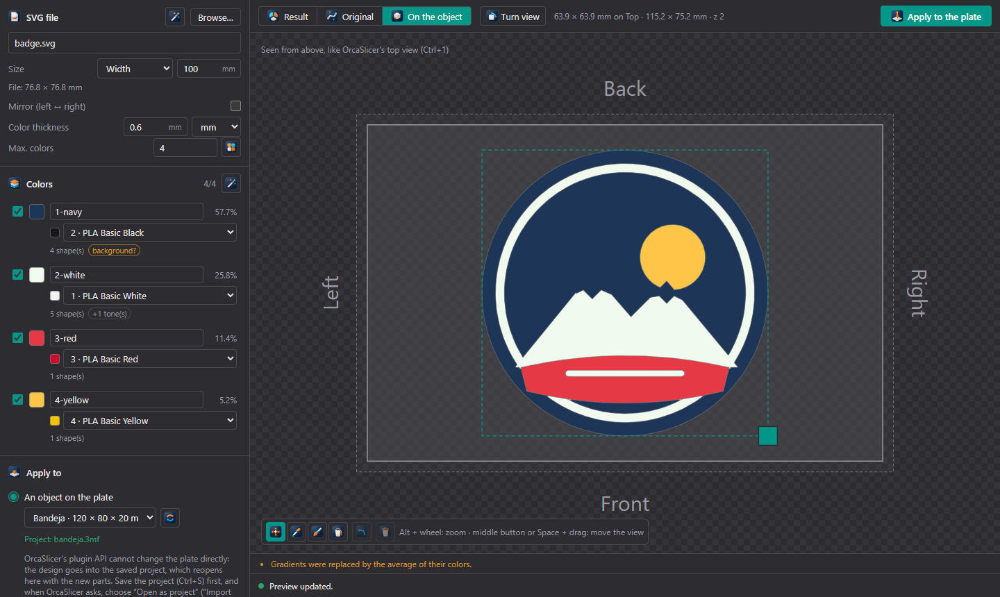
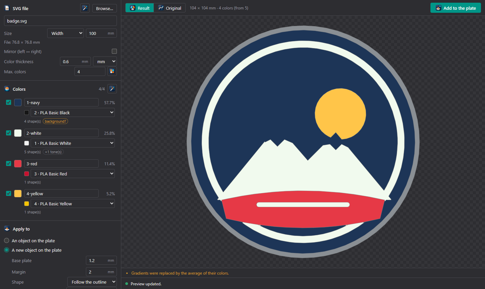
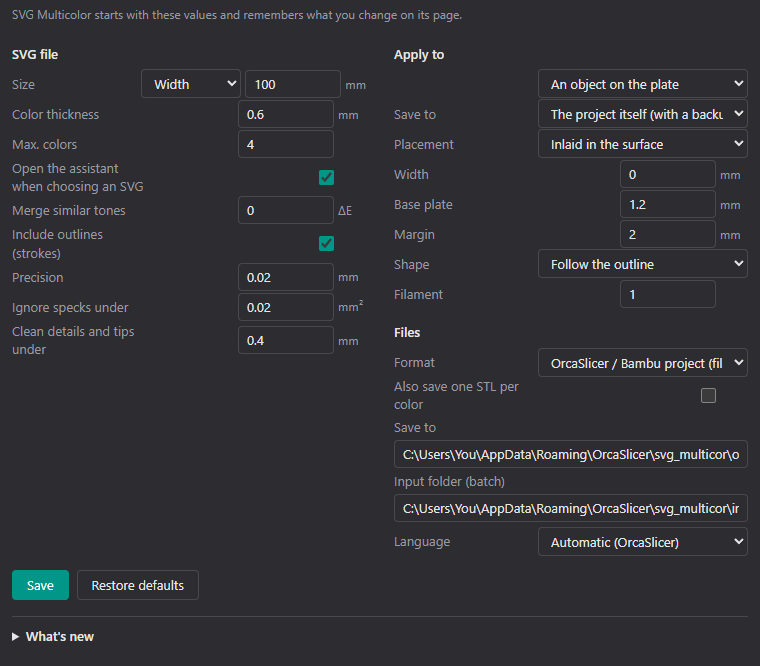

# SVG Multicolor for OrcaSlicer

[](https://github.com/opoeta/orca-svg-multicor/actions/workflows/ci.yml)
[](LICENSE)
[](https://github.com/opoeta/orca-svg-multicor/releases/latest)

**[Leia em português](README.pt-BR.md)**

An OrcaSlicer plugin that turns a multicolor SVG (a logo, a sign, a sticker design)
into **one printable part per color**, all aligned in the same frame and already
assigned to your filaments.



## What it does

- **New 3MF**: one object with one part per color, named and assigned to a
  filament, optionally on top of a **base plate** (following the outline, or a
  rounded rectangle). Opens in OrcaSlicer / Bambu Studio ready to slice. A
  standard 3MF (with colors) is also available for other slicers, plus one STL
  per color.
- **Apply to a project**: adds the colors as new parts of an object in a saved
  project, on the flat **surface you choose** (the floor of a tray, a side, the
  inside of a wall, the bottom...), **inlaid** (the object keeps its shape, the
  surface changes color) or **raised**, rotated as you like. Works with the projects OrcaSlicer and Bambu
  Studio save today. The project is updated in place, its previous version
  kept as a backup, or a copy is written instead.
- **Sees the SVG like a browser does**: shapes painted later cover earlier
  ones, so the parts fit together instead of overlapping; fill rules
  (nonzero / evenodd) are exact; outlines (strokes) become printable areas;
  gradients use the average of their colors; hidden and fully transparent
  shapes are skipped; CSS classes, `<use>`, transforms and physical units
  (`width="80mm"`) are understood.
- **Fits your printer**: limits the number of colors to your filaments by
  merging the least significant ones into the most similar (CIEDE2000),
  merges near-identical tones, and can hand details thinner than the nozzle to
  the neighboring color.
- **Reads your filaments** from OrcaSlicer and matches each color to the closest
  one. Live preview, per-color names, filaments and on/off switches.
- **13 languages**, following OrcaSlicer's language automatically: English,
  Português (Brasil), Español, Français, Deutsch, Italiano, Polski, Türkçe,
  Русский, Українська, 简体中文, 日本語, 한국어.

## Installing

**From OrcaCloud (recommended)**: subscribe to
[SVG Multicolor](https://cloud.orcaslicer.com/p/51a884bf98ad) in the Plugin Hub,
then tick it in OrcaSlicer's **File > Plugins** (signed in with the same
OrcaCloud account; *Refresh* if it is not listed yet). OrcaSlicer then shows
its image in *Plugin Info*, what's new in the *Changelog* tab, and offers
each new version. OrcaSlicer fills those only for plugins that come from
OrcaCloud.

**From a file**:

1. Download `orca_svg_multicor-<version>-py3-none-any.whl` from the
   [latest release](https://github.com/opoeta/orca-svg-multicor/releases/latest).
2. In OrcaSlicer, open the **Plugins** dialog and install the `.whl` file as a
   local plugin. OrcaSlicer installs the dependencies (numpy, shapely,
   svgelements, mapbox-earcut) by itself.

Either way, keep only one copy: delete the other one in the Plugins dialog
first (both would load the same Python package). The settings carry over.
Enable the plugin. It adds:
   - **SVG Multicolor**: a page next to Prepare and Preview;
   - **SVG Multicolor - batch**: converts every SVG of the input folder with the
     same settings, from the Plugins dialog's Run action.

   Builds of OrcaSlicer without plugin pages get **SVG Multicolor - window**
   instead: the same page in a window.

> **Upgrading from 2.x**: remove the old plugin first. Both versions use the same
> Python package name and cannot be loaded side by side.

Requires an OrcaSlicer build with Python plugin support.

## Using it

The page works like the Prepare tab: settings on the left, the view on the
right, the main action at the top right.

1. **SVG file**: *Browse…* and choose the SVG. The **assistant** opens beside
   the drawing and goes one step at a time (the wand next to *Browse…* brings
   it back; the Config tab can turn it off):
   - **Drawing**: which layers of the file to use (Illustrator and Inkscape
     layers; the design keeps its size and place), the size, and **Mirror**.
   - **Colors**: the drawing with 2, 3 ... 12 colors (the count of your
     filaments is marked); click one.
   - **Filaments**: a filament for each color, the wand that matches them to
     the loaded filaments, and **Drawing colors in the project's filaments**:
     when applying to the plate, each filament used takes the color of its part.
   - **Finish**: edges *Detailed*, *Normal* or *Simplified*, the color
     thickness and, on an object, the surface, first layer, position (a 3×3
     grid: corners, sides, center) and rotation.

   Every step is also in the sidebar.
2. **Colors**: hover a row to highlight it in the view. Rename parts, untick
   what you do not want (a plain background, for example; colors that span the
   whole drawing are tagged *background?*), and pick each color's filament, or
   let the wand match them to the filaments loaded in OrcaSlicer. Or **click a
   color in the drawing** (Ctrl+click to add more) and choose its filament: the
   drawing shows the filament's color. The color square of a row changes the
   color of that part; ↺ brings the original back.
3. **Apply to**:
   - **An object on the plate**: save the project (Ctrl+S), pick the object
     and the **surface** the design goes on. The list has every flat face of
     the object, named as you see them on the plate (*Top*, *Front*,
     *Front (inner)* for the inside of the front wall...) with their size; the
     face lying on the bed is chosen at first (the design in the first
     layers). The **On the object** view shows that face as OrcaSlicer does,
     turned like the object on the plate (the bottom as in its bottom view,
     with the front of the plate up), and the design along the object's
     edges; around it, the whole object seen from that side (tabs, notches),
     the sides of the plate and the OrcaSlicer view that shows it the same
     way (Ctrl+1 to Ctrl+6); the ↻ button turns that view by quarter turns
     (only the view). There you **drag it to move it and drag its corner to
     resize it** (Shift + corner: width and height on their own). The design
     may go past the surface, up to covering it and 25% more: what goes past
     its edge is cut off, and moving it chooses what shows. **Fill** covers
     the whole surface in proportion, centered, with no edge left over
     (*Center* puts it back in the middle). The toolbar under the view
     paints on the surface: the **dropper** (or Ctrl + click, as in
     Photoshop) copies a color of the drawing, the **brush** paints with it
     (a click or a drag always paints), the **bucket** gives
     a whole area (of one color, or bare) that color; with no color picked
     they use the color next to it. Painted areas are printed with their
     colors, in the same layers (undo, clear). Choose the **rotation**, *inlaid*
     (the surface changes color) or *raised*, the width (empty = 85% of the
     face) and the height (empty = in proportion). On the face lying
     on the bed, **First layer** chooses whether the design starts on the first
     layer or just above it (the first layer stays the object's color). Then
     **Apply to the plate**. OrcaSlicer's plugin API cannot change the
     plate directly, so the design goes into the saved project, which reopens
     in OrcaSlicer with the new parts. **Save to** chooses where the result
     goes: *the project itself* (default; the previous version is first copied
     to `<OrcaSlicer data folder>/svg_multicor/backups`, the last 20 are kept)
     or *a copy*, `*_svg.3mf` in the output folder.
   - **A new object on the plate**: optionally on a base plate, then **Add to
     the plate**; OrcaSlicer opens the new 3MF.



The page remembers the values you change. Defaults, the output folder, the
file format, STL export and the language are in the Plugins dialog, **Config**
tab. Installed from a file, the Config tab also has what's new in each
version (in Portuguese when OrcaSlicer is in Portuguese), since the Changelog
tab stays empty for local plugins.



### Settings

| Setting | Meaning |
| --- | --- |
| Size | Width, height, or the SVG's own physical size |
| Color thickness | Height of the color parts, in mm or in **layers** (of the project's or printer profile's layer height, or the one in Advanced) |
| Max. colors | Merge colors down to this number (0 = no limit) |
| Merge similar tones | Joins colors closer than this ΔE (0 = off) |
| Include outlines | Turns strokes into printable areas |
| Base plate | Thickness (0 = none), margin, shape and filament |
| Precision | Simplification tolerance (mm) |
| Ignore specks under | Drops islands and holes smaller than this area (mm²) |
| Clean details and tips under | On by default (0.4 mm): lines and sharp tips a nozzle that wide cannot print go to the neighboring color, without gaps, and corners round to half of it (0 = off) |

### Good to know

- **Text** must be converted to paths (outlines) in your editor; **bitmap
  images** are ignored; **clipping paths and masks** are ignored (release them
  if shapes show up where they should not). The panel warns about all of these.
- The **file dialog** runs as a separate process (PowerShell on Windows,
  `osascript` on macOS, `zenity`/`kdialog` on Linux); OrcaSlicer asks once
  whether the plugin may start a process, and if you say no, the page offers to
  upload a copy of the SVG instead. Results are handed to the OrcaSlicer window
  already open, the way its own launcher does; starting OrcaSlicer's
  executable is the fallback.
- OrcaSlicer refuses plugins any path with "conf", "cert" or "secret" in a
  name, including numpy's own `numpy/__config__.py`, so the plugin loads its
  libraries (numpy, shapely) when OrcaSlicer starts, which takes a moment.
  Keep SVGs and projects out of folders with those words in the name.
- When the result reopens on a plate that already has objects, OrcaSlicer
  asks how to load it (Preferences, "Load behaviour": ask when relevant).
  Choose **Open as project**: *Import geometry only* adds the objects again
  on top of the ones already there (Ctrl+Z undoes it). "Load all" in that
  preference opens projects without asking.
- Inlaying relies on OrcaSlicer giving parts added later priority where parts
  overlap, the same mechanism used when you add a part inside an object by hand.
- OrcaSlicer's **Plugins dialog shows an image and a changelog only for plugins
  installed from OrcaCloud**; for a local `.whl` both stay empty by design. Once
  the plugin is on OrcaCloud, install it from the Plugin Hub to get them
  ([docs/orcacloud](docs/orcacloud/README.md)). The changelog is also in the
  plugin's Config tab and in [CHANGELOG.md](CHANGELOG.md)
  ([Português](CHANGELOG.pt-BR.md)).
- Files live in `<OrcaSlicer data folder>/svg_multicor/` (input, output and
  `plugin.log`); both folders can be changed in the Config tab.

## Adding a language

Copy `src/orca_svg_multicor/locales/en.json` to `<code>.json` (the code
OrcaSlicer uses, such as `nl` or `zh_TW`), translate the values, keep every
`{placeholder}`, set `_meta.name` to the language's own name, and run the tests.
See [CONTRIBUTING.md](CONTRIBUTING.md).

## Development

```bash
python -m venv .venv
.venv/bin/pip install -e . -r requirements-dev.txt   # Windows: .venv\Scripts\pip
.venv/bin/pytest
python tools/dev_server.py --lang pt_BR --project some.3mf   # the page in a browser, OrcaSlicer's look, fake plate
python -m build --wheel                   # dist/orca_svg_multicor-<version>-py3-none-any.whl
```

The code is split so that everything except `capabilities.py` runs without
OrcaSlicer:

| Module | Role |
| --- | --- |
| `svgread.py` | SVG → ordered paint operations (fills and strokes) |
| `geometry.py` | fill rules, occlusion, cleanup, base plate, preview |
| `colors.py` | CIEDE2000, naming, merging and reducing colors, filament matching |
| `mesh.py` | extrusion, watertightness check, STL |
| `threemf.py` | OrcaSlicer/Bambu project layout and standard 3MF writers |
| `project3mf.py` | reading and editing saved projects |
| `faces.py` | the flat surfaces of an object, placing a design on one |
| `engine.py` | analyze / generate / apply pipeline |
| `service.py` | messages between the page and the engine, translated |
| `host.py` | OrcaSlicer host API, native pickers, log |
| `capabilities.py` | the OrcaSlicer capabilities |
| `ui/` | the panel (HTML, CSS, JS; no external resources) |

## Credits

Created by Israel Fernandes. Released under the [MIT license](LICENSE).
