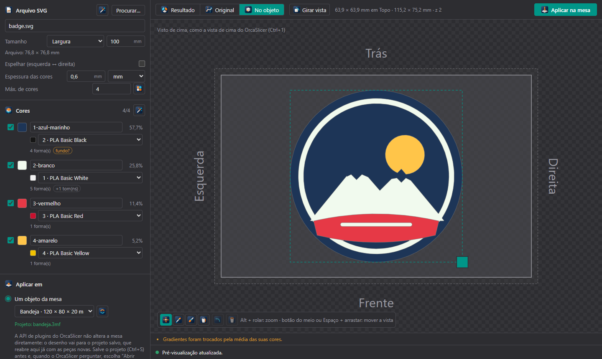
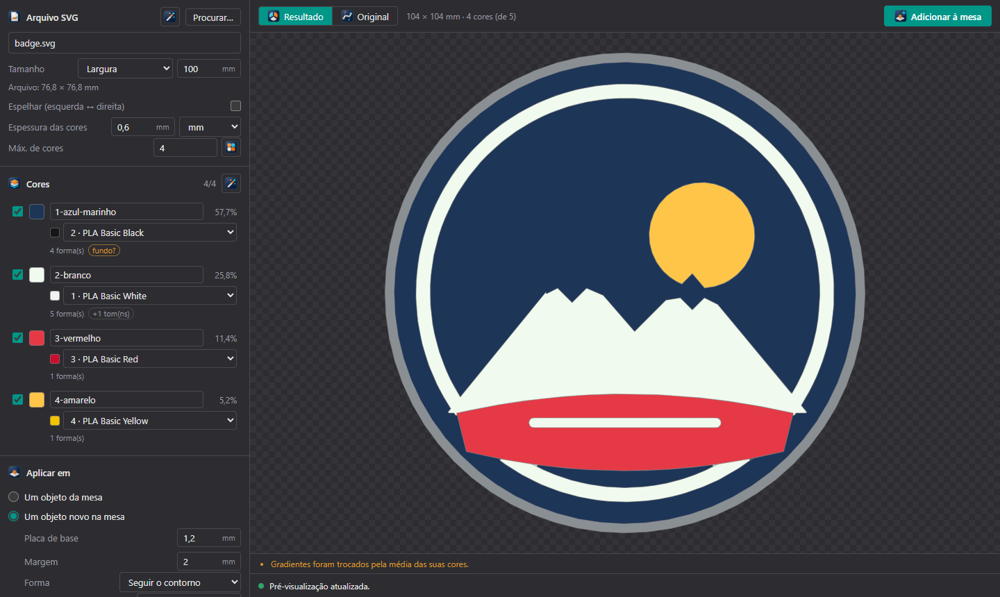
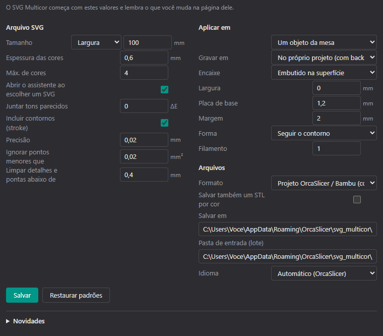

# SVG Multicor para OrcaSlicer

**[Read in English](README.md)**

Plugin do OrcaSlicer que transforma um SVG colorido (logo, placa, adesivo) em
**uma peça imprimível por cor**, todas alinhadas no mesmo referencial e já
atribuídas aos seus filamentos.

## O que ele faz

- **3MF novo**: um objeto com uma peça por cor, com nome e filamento, opcionalmente
  sobre uma **placa de base** (seguindo o contorno ou em retângulo
  arredondado). Abre no OrcaSlicer / Bambu Studio pronto para fatiar. Também gera
  3MF padrão (com cores) para outros fatiadores e um STL por cor.
- **Aplicar num projeto**: acrescenta as cores como novas peças de um objeto de
  um projeto salvo, na **superfície plana que você escolher** (o fundo de uma
  bandeja, uma lateral, o lado de dentro de uma parede, a base...),
  **embutidas** (o objeto mantém a forma, a superfície muda de cor) ou **em
  relevo**, com a rotação que quiser. Funciona com os projetos que o
  OrcaSlicer e o Bambu Studio salvam hoje. O projeto é atualizado no próprio
  arquivo, com a versão anterior guardada num backup, ou numa cópia.
- **Enxerga o SVG como o navegador**: o que é pintado depois cobre o que veio
  antes, então as peças se encaixam em vez de se sobreporem; as regras de
  preenchimento (nonzero / evenodd) são exatas; contornos (stroke) viram áreas
  imprimíveis; gradientes usam a média das cores; formas ocultas ou totalmente
  transparentes são ignoradas; entende classes CSS, `<use>`, transformações e
  unidades físicas (`width="80mm"`).
- **Cabe na sua impressora**: limita o número de cores aos seus filamentos
  juntando as menos importantes na mais parecida (CIEDE2000), junta tons quase
  iguais e pode passar detalhes mais finos que o bico para a cor vizinha.
- **Lê os filamentos** do OrcaSlicer e casa cada cor com o mais próximo.
  Pré-visualização ao vivo, nome, filamento e liga/desliga por cor.
- **13 idiomas**, seguindo o idioma do OrcaSlicer automaticamente.

## Instalação

**Pela OrcaCloud (recomendado)**: assine o
[SVG Multicolor](https://cloud.orcaslicer.com/p/51a884bf98ad) no Plugin Hub e
marque-o em **Arquivo > Plugins** no OrcaSlicer (com a mesma conta da
OrcaCloud; *Atualizar* se ainda não aparecer). Assim o OrcaSlicer mostra a
imagem em *Plugin Info*, as novidades na aba *Changelog* e oferece cada versão
nova. O OrcaSlicer só preenche isso para plugins que vêm da OrcaCloud.

**Por arquivo**:

1. Baixe `orca_svg_multicor-<versão>-py3-none-any.whl` na
   [última versão](https://github.com/opoeta/orca-svg-multicor/releases/latest).
2. No OrcaSlicer, abra a janela de **Plugins** e instale o `.whl` como plugin
   local. O OrcaSlicer instala as dependências (numpy, shapely, svgelements,
   mapbox-earcut) sozinho.

Nos dois casos, mantenha uma cópia só: apague a outra na janela de Plugins
antes (as duas carregariam o mesmo pacote Python). As configurações são
mantidas. Ative o plugin. Ele acrescenta:
   - **SVG Multicolor**: uma página ao lado de Preparar e Visualizar;
   - **SVG Multicolor - batch**: converte todos os SVGs da pasta de entrada com
     as mesmas configurações, pela ação Executar do diálogo de Plugins.

   Versões do OrcaSlicer sem páginas de plugin recebem **SVG Multicolor -
   window**: a mesma página numa janela.

> **Atualizando da 2.x**: remova o plugin antigo antes. As duas versões usam o
> mesmo nome de pacote Python e não podem ser carregadas juntas.

## Como usar

A página funciona como a aba Preparar: ajustes à esquerda, visualização à
direita e a ação principal no canto superior direito.

1. **Arquivo SVG**: *Procurar…* e escolha o SVG. O **assistente** abre ao
   lado do desenho e vai um passo de cada vez (a varinha ao lado de
   *Procurar…* o traz de volta; a aba Config pode desligá-lo):
   - **Desenho**: quais camadas do arquivo usar (camadas do Illustrator e do
     Inkscape; o desenho mantém tamanho e lugar), o tamanho e **Espelhar**.
   - **Cores**: o desenho com 2, 3 ... 12 cores (o número dos seus filamentos
     vem marcado); clique numa.
   - **Filamentos**: um filamento para cada cor, a varinha que casa com os
     filamentos carregados e **Cores do desenho nos filamentos do projeto**: ao
     aplicar na mesa, cada filamento usado fica com a cor da sua peça.
   - **Acabamento**: arestas *Detalhado*, *Normal* ou *Simplificado*, a
     espessura das cores e, num objeto, a superfície, a primeira camada, a
     posição (grade 3×3: cantos, lados, centro) e a rotação.

   Tudo isso também fica na barra lateral.
2. **Cores**: passe o mouse numa linha para destacá-la na visualização.
   Renomeie as peças, desmarque o que não quer (um fundo, por exemplo; cores que
   ocupam o desenho inteiro recebem a etiqueta *fundo?*) e escolha o filamento
   de cada cor, ou deixe a varinha casar com os filamentos carregados no Orca.
   Ou **clique numa cor do desenho** (Ctrl+clique para juntar mais) e escolha o
   filamento: o desenho mostra a cor do filamento. O quadrado de cor de uma
   linha muda a cor daquela peça; o ↺ volta à original.
3. **Aplicar em**:
   - **Um objeto da mesa**: salve o projeto (Ctrl+S), escolha o objeto e a
     **superfície** onde o desenho vai. A lista traz todas as faces planas do
     objeto, com os nomes que você vê na mesa (*Topo*, *Frente*, *Frente
     (interna)* para o lado de dentro da parede da frente...) e o tamanho; de
     início fica a face apoiada na mesa (o desenho nas primeiras camadas). A
     visualização **No objeto** mostra essa face como o OrcaSlicer mostra,
     girada como o objeto está na mesa (o fundo como na vista de baixo dele,
     com a frente da mesa para cima), e o desenho alinhado às bordas do
     objeto; em volta, o objeto inteiro visto daquele lado (abas, encaixes),
     os lados da mesa e a vista do OrcaSlicer que mostra igual (Ctrl+1 a
     Ctrl+6); o botão ↻ gira essa vista de 90 em 90° (só a vista). Ali você
     **arrasta para mover e puxa o canto para mudar o tamanho** (Shift +
     canto: largura e altura independentes). O desenho pode passar da
     superfície, até cobri-la e mais 25%: o que passa da borda é cortado, e
     mover escolhe o que aparece. **Preencher** cobre a superfície inteira,
     proporcional e centralizado, sem sobrar borda (*Centralizar* volta ao
     meio). Escolha a **rotação**, o encaixe (*embutido*: a superfície muda de
     cor; ou *em relevo*), a largura (vazio = 85% da face) e a altura (vazio =
     proporcional). Na face apoiada na mesa, **Primeira camada** escolhe se o
     desenho começa na 1ª camada ou logo acima dela (a 1ª fica da cor do
     objeto). Depois clique em **Aplicar na mesa**. A API de plugins do OrcaSlicer não
     altera a mesa diretamente, então o desenho vai para o projeto salvo, que
     reabre no OrcaSlicer já com as peças novas. **Gravar em** escolhe onde o
     resultado fica: *no próprio projeto* (padrão; antes, a versão anterior é
     copiada para `<pasta de dados do OrcaSlicer>/svg_multicor/backups`, que
     guarda as últimas 20) ou *numa cópia*, `*_svg.3mf` na pasta de saída.
   - **Um objeto novo na mesa**: com ou sem placa de base, clique em
     **Adicionar à mesa**; o OrcaSlicer abre o 3MF novo.

A página lembra os valores que você muda. Os padrões, a pasta de saída, o
formato, o STL e o idioma ficam no diálogo de Plugins, aba **Config**.
Instalado por arquivo, a aba Config também traz as novidades de cada versão,
em português quando o OrcaSlicer está em português, porque a aba Changelog
fica vazia para plugins locais.

### Bom saber

- **Texto** precisa ser convertido em curvas no editor; **imagens bitmap** são
  ignoradas; **máscaras e recortes** são ignorados. O painel avisa sobre tudo
  isso.
- A **janela de seleção de arquivo** roda como processo separado (PowerShell no
  Windows); o OrcaSlicer pergunta uma vez se o plugin pode iniciar um processo,
  e se você negar, a página oferece enviar uma cópia do SVG. O resultado é
  entregue à janela do OrcaSlicer já aberta, do mesmo jeito que o próprio
  inicializador dele faz; iniciar o executável do OrcaSlicer fica como
  alternativa.
- Quando o resultado reabre numa mesa que já tem objetos, o OrcaSlicer
  pergunta como carregá-lo (Preferências, "Comportamento ao carregar":
  perguntar quando relevante). Escolha **Abrir como projeto**: *Importar
  somente geometria* soma os objetos de novo aos que já estão na mesa (Ctrl+Z
  desfaz). "Carregar tudo" nessa preferência abre os projetos sem perguntar.
- O OrcaSlicer recusa aos plugins qualquer caminho com "conf", "cert" ou
  "secret" no nome, inclusive o `numpy/__config__.py` do próprio numpy; por
  isso o plugin carrega as bibliotecas dele (numpy, shapely) quando o
  OrcaSlicer abre, o que leva um instante. Mantenha SVGs e projetos fora de
  pastas com essas palavras no nome.
- A janela de **Plugins do OrcaSlicer só mostra imagem e changelog para plugins
  instalados pela OrcaCloud**; num `.whl` local os dois ficam vazios por projeto
  do Orca. Quando o plugin estiver na OrcaCloud, instale pela Plugin Hub para
  tê-los ([docs/orcacloud](docs/orcacloud/README.md)). O changelog também está
  na aba Config do plugin e em [CHANGELOG.pt-BR.md](CHANGELOG.pt-BR.md).
- Se o OrcaSlicer perguntar se o plugin pode iniciar um processo ao usar
  "Procurar…", pode responder Sim: é a janela nativa de seleção de arquivos.
- Os arquivos ficam em `<pasta de dados do OrcaSlicer>/svg_multicor/`
  (entrada, saída e `plugin.log`).

## Créditos

Criado por Israel Fernandes. Licença [MIT](LICENSE).
